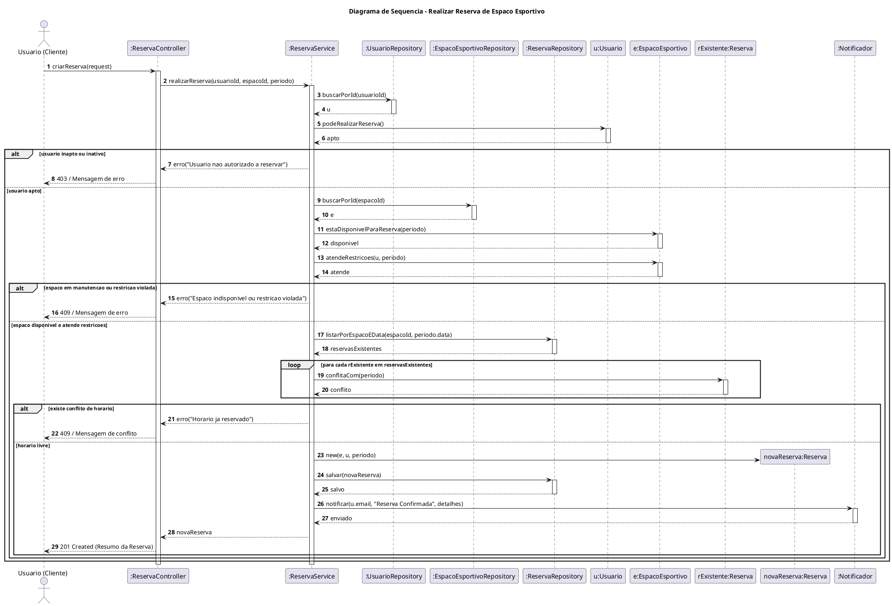
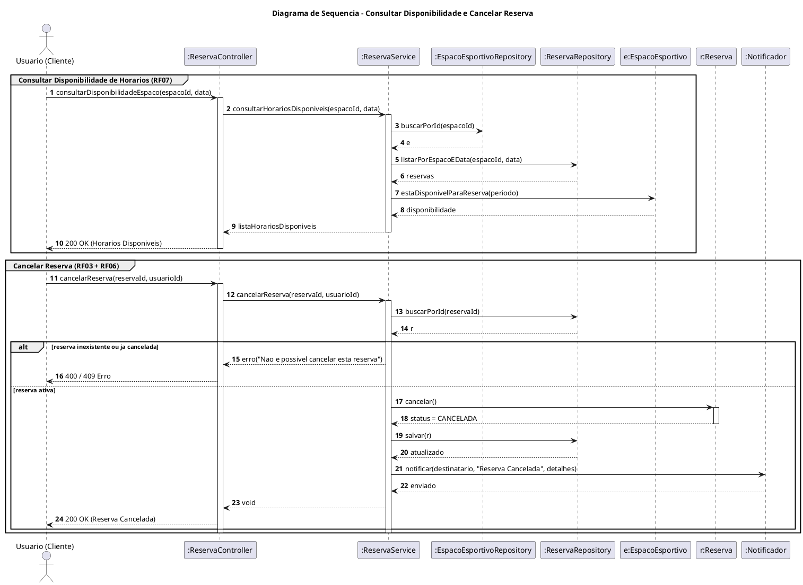
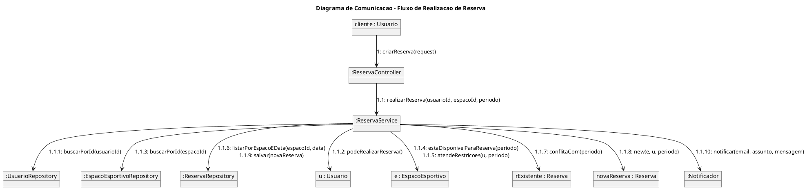
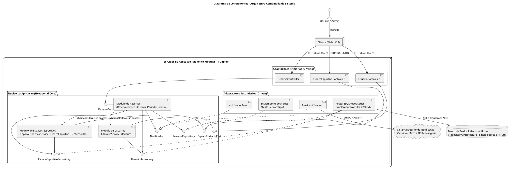

# Documentação Consolidada do Projeto — Sistema de Locação de Espaços Esportivos

> **Finalidade deste documento:** Centralizar todas as definições teóricas, requisitos, modelagem de domínio, responsabilidades (GRASP e SOLID), diagramas UML (em sintaxe PlantUML pronta para o site [PlantText](https://www.planttext.com/)), arquitetura proposta, análise de trade-offs, ADRs e análise de evolução em um único arquivo para **validação final da equipe** antes de iniciar a implementação do protótipo.

---

## Visão Geral e Questão Central do Projeto

**Tema 14 — Locação de espaços esportivos:** Sistema para organizar reservas de quadras e outros espaços esportivos, controlando horários, restrições de uso, cancelamentos e períodos de manutenção.

**Resposta executiva à questão norteadora do trabalho (*"Como este sistema deve ser organizado para atender aos requisitos atuais e permitir sua evolução sem gerar dependências desnecessárias?"*):**  
O sistema será estruturado seguindo o **estilo Cliente-Servidor** na fronteira de acesso, organizado internamente como um **Monólito Modular** com **Arquitetura Hexagonal (Ports & Adapters)** no núcleo de cada domínio e **Repository Architecture** (banco de dados relacional centralizado) como fonte única da verdade. Essa combinação garante consistência transacional forte contra reservas duplicadas (**ASR1**), isola integrações externas por meio de portas e adaptadores para permitir a troca ou adição de canais de notificação sem impactar o domínio (**ASR2**) e mantém a complexidade operacional compatível com uma equipe reduzida de 3 pessoas e alta testabilidade (**ASR3**).

---

## 1. Descrição do Problema e Requisitos

### 1.1 Contexto do Sistema

Em ambientes universitários, clubes ou complexos esportivos, a locação de quadras e espaços físicos costuma enfrentar problemas recorrentes como conflitos de agendamento no mesmo horário (*double booking*), dificuldade em visualizar horários ou espaços livres, reservas feitas em períodos de manutenção e aplicação inconsistente de regras de uso específicas de cada espaço.  

O sistema proposto centraliza o controle de espaços esportivos, regras de utilização, agendas de reserva, bloqueios de manutenção e notificações aos usuários, oferecendo uma base coesa e preparada para evoluir sem acoplamento rígido a tecnologias de interface, banco de dados ou provedores de envio de mensagens.

### 1.2 Principais Atores

* **Atores Primários (iniciam casos de uso):**
  * **Usuário (Cliente):** Consulta disponibilidade de horários e espaços, efetua reservas e cancela suas próprias reservas.
  * **Administrador (`Admin`):** Cadastra novos espaços esportivos, registra ou encerra períodos de manutenção, define/altera restrições de uso dos espaços e cadastra novos usuários (clientes).
* **Ator Secundário / Sistema Externo (acionado pelo sistema):**
  * **Sistema Externo de Notificação:** Serviço externo responsável por entregar avisos de confirmação ou cancelamento de reserva ao usuário (inicialmente via e-mail, extensível para WhatsApp/SMS).

> **Nota conceitual:** O **Banco de Dados** não atua como ator de negócio (não possui intenção nem interage autonomamente), sendo modelado como **componente de infraestrutura / persistência** dentro da *Repository Architecture* e acessado por adaptadores secundários.

### 1.3 Requisitos Funcionais (RF01 a RF10)

| ID | Requisito Funcional | Ator Principal | Módulo Responsável |
| :--- | :--- | :--- | :--- |
| **RF01** | Cadastrar novo espaço esportivo | Administrador | Espaços Esportivos |
| **RF02** | Reservar espaços esportivos | Usuário (Cliente) | Reservas |
| **RF03** | Cancelar reserva | Usuário (Cliente) | Reservas |
| **RF04** | Alterar disponibilidade para período de manutenção (impedindo reserva pelo cliente) | Administrador | Espaços Esportivos / Reservas |
| **RF05** | Impedir duas reservas no mesmo horário no mesmo espaço | Sistema / Reservas | Reservas |
| **RF06** | Notificar usuário após reserva ser efetuada ou cancelada | Sistema Externo de Notificação | Notificação |
| **RF07** | Consultar disponibilidade de horário em um espaço | Usuário (Cliente) | Reservas / Espaços Esportivos |
| **RF08** | Consultar disponibilidade de espaços em um horário | Usuário (Cliente) | Reservas / Espaços Esportivos |
| **RF09** | Definir/alterar restrições de uso para cada espaço | Administrador | Espaços Esportivos |
| **RF10** | Criar novos usuários (clientes) | Administrador | Usuários |

### 1.4 Restrições Relevantes

1. **R01 — Evolução desacoplada:** Permitir evolução do projeto sem gerar dependências desnecessárias entre regras de negócio e infraestrutura.
2. **R02 — Equipe reduzida:** Projeto desenvolvido e mantido por apenas 3 integrantes.
3. **R03 — Tempo e recursos limitados:** Necessidade de manter implantação simples e baixo custo operacional.
4. **R04 — Consistência dos dados:** O sistema deve garantir consistência satisfatória dos dados de agenda e disponibilidade.
5. **R05 — Testabilidade:** As regras críticas de negócio devem ser facilmente testáveis de forma automatizada.

### 1.5 Requisitos Arquiteturalmente Significativos (ASRs) e Justificativas

| ASR | Descrição Concreta (Cenário Verificável) | Influência nas Decisões Arquiteturais |
| :--- | :--- | :--- |
| **ASR1 — Dados Centralizados e Consistência Forte nas Reservas** | Quando dois ou mais clientes solicitam reserva para o mesmo espaço esportivo em períodos sobrepostos simultaneamente, ou quando um administrador coloca o espaço em manutenção no mesmo instante, o sistema deve garantir consistência transacional estrita (ACID) para que **zero reservas duplicadas ou inválidas** sejam persistidas. | Impede a adoção de múltiplos bancos isolados com consistência eventual (como em microsserviços) e direciona para o estilo **Repository Architecture** (fonte única da verdade em banco relacional centralizado) dentro de um **Monólito Modular**. |
| **ASR2 — Modificabilidade para Novos Canais de Notificação** | Quando for necessário substituir o canal de notificação atual (ex.: E-mail) ou adicionar novos provedores (ex.: WhatsApp, SMS ou *Fake* para testes), a troca deve ocorrer implementando apenas um novo adaptador, sem alterar nenhuma classe de domínio ou caso de uso de reserva. | Motiva a adoção da **Arquitetura Hexagonal (Ports & Adapters)** com o princípio **DIP**, definindo uma porta de saída explícita (`Notificador`) que desacopla o núcleo do provedor concreto. |
| **ASR3 — Manutenibilidade e Testabilidade em Equipe Reduzida** | Uma equipe de 3 pessoas deve conseguir manter módulos de negócio independentes em nível lógico e executar a suíte de testes unitários das regras de reserva, manutenção e restrições em milissegundos, sem depender de banco de dados ou servidor SMTP em execução. | Descarta microsserviços devido à sobrecarga operacional e direciona para um **Monólito Modular** (fronteiras lógicas claras, 1 único deploy) aliado ao núcleo puro da **Arquitetura Hexagonal**, viabilizando testes em memória via *mocks/fakes*. |

---

## 2. Modelo de Domínio e Responsabilidades

### 2.1 Divisão em Módulos Internos

Dentro do **Monólito Modular**, o sistema é organizado em quatro módulos coesos que se comunicam por chamadas locais e contratos claros:

1. **Módulo de Espaços Esportivos:** Gestão do cadastro de quadras/espaços, restrições de uso e períodos de manutenção (RF01, RF04, RF07, RF08, RF09).
2. **Módulo de Reservas (Core Principal):** Orquestração do agendamento, checagem de conflitos de horário, cancelamentos e consultas de disponibilidade (RF02, RF03, RF05).
3. **Módulo de Usuários:** Gestão de cadastro e validação de aptidão de clientes e administradores (RF10).
4. **Módulo de Notificação (Integração Externa):** Contrato (`Notificador`) e adaptadores responsáveis por enviar confirmações e avisos de cancelamento (RF06).

### 2.2 Principais Classes, Interfaces e Responsabilidades

#### A) Núcleo / Domínio (Entidades, Objetos de Valor e Enums)

* **`EspacoEsportivo` (Entidade):**
  * *Atributos:* `id: UUID`, `nome: String`, `tipo: String`, `capacidade: int`, `emManutencao: boolean`, `periodosManutencao: List<PeriodoHorario>`, `restricoesUso: List<RestricaoUso>`.
  * *Métodos:* `estaDisponivelParaReserva(periodo: PeriodoHorario): boolean`, `atendeRestricoes(usuario: Usuario, periodo: PeriodoHorario): boolean`, `iniciarManutencao(periodo: PeriodoHorario): void`, `encerrarManutencao(): void`, `adicionarRestricao(restricao: RestricaoUso): void`.
* **`Reserva` (Entidade):**
  * *Atributos:* `id: UUID`, `espacoEsportivo: EspacoEsportivo`, `usuario: Usuario`, `periodoHorario: PeriodoHorario`, `status: StatusReserva`.
  * *Métodos:* `cancelar(): void`, `estaAtiva(): boolean`, `conflitaCom(outroPeriodo: PeriodoHorario): boolean`.
* **`PeriodoHorario` (Value Object):**
  * *Atributos:* `data: LocalDate`, `horaInicio: LocalTime`, `horaFim: LocalTime`.
  * *Métodos:* `sobrepoe(outroPeriodo: PeriodoHorario): boolean`, `ehValido(): boolean`.
* **`RestricaoUso` (Value Object / Entidade):**
  * *Atributos:* `descricao: String`, `duracaoMaximaMinutos: int`, `antecedenciaMinimaHoras: int`, `apenasUsuariosAutorizados: boolean`.
  * *Métodos:* `validar(usuario: Usuario, periodo: PeriodoHorario): boolean`.
* **`Usuario` (Entidade):**
  * *Atributos:* `id: UUID`, `nome: String`, `email: String`, `telefone: String`, `perfil: TipoPerfil`, `ativo: boolean`.
  * *Métodos:* `podeRealizarReserva(): boolean`.
* **Enums:** `StatusReserva` (`CONFIRMADA`, `CANCELADA`) e `TipoPerfil` (`CLIENTE`, `ADMIN`).

#### B) Aplicação / Serviços de Casos de Uso (Coordenação — Portas Primárias)

* **`ReservaService`:**
  * *Métodos:* `realizarReserva(usuarioId: UUID, espacoId: UUID, periodo: PeriodoHorario): Reserva`, `cancelarReserva(reservaId: UUID, usuarioId: UUID): void`, `consultarHorariosDisponiveis(espacoId: UUID, data: LocalDate): List<PeriodoHorario>`, `consultarEspacosDisponiveis(periodo: PeriodoHorario): List<EspacoEsportivo>`.
  * *Responsabilidade:* Orquestrar repositórios, entidades do domínio e o `Notificador` sem absorver regras que pertencem às entidades.
* **`EspacoEsportivoService`:**
  * *Métodos:* `cadastrarEspaco(nome: String, tipo: String, capacidade: int): EspacoEsportivo`, `agendarManutencao(espacoId: UUID, periodo: PeriodoHorario): void`, `liberarManutencao(espacoId: UUID): void`, `definirRestricoes(espacoId: UUID, restricoes: List<RestricaoUso>): void`.
* **`UsuarioService`:**
  * *Métodos:* `cadastrarUsuario(nome: String, email: String, telefone: String, perfil: TipoPerfil): Usuario`, `buscarUsuario(usuarioId: UUID): Usuario`.

#### C) Adaptadores Primários (Controllers / Camada de Entrada)

* **`ReservaController`:** `criarReserva(request)`, `cancelarReserva(reservaId, usuarioId)`, `consultarDisponibilidadeEspaco(espacoId, data)`, `consultarEspacosDisponiveis(data, horaInicio, horaFim)`.
* **`EspacoEsportivoController`:** `cadastrarEspaco(request)`, `agendarManutencao(espacoId, request)`, `definirRestricoes(espacoId, request)`.
* **`UsuarioController`:** `cadastrarUsuario(request)`.

#### D) Portas Secundárias (Interfaces de Saída no Núcleo)

* **`Notificador`:** `notificar(destinatario: String, assunto: String, mensagem: String): void`.
* **`ReservaRepository`:** `salvar(reserva: Reserva): void`, `buscarPorId(id: UUID): Reserva`, `listarPorEspacoEData(espacoId: UUID, data: LocalDate): List<Reserva>`, `listarAtivasPorPeriodo(periodo: PeriodoHorario): List<Reserva>`.
* **`EspacoEsportivoRepository`:** `salvar(espaco: EspacoEsportivo): void`, `buscarPorId(id: UUID): EspacoEsportivo`, `listarTodos(): List<EspacoEsportivo>`.
* **`UsuarioRepository`:** `salvar(usuario: Usuario): void`, `buscarPorId(id: UUID): Usuario`.

#### E) Adaptadores Secundários (Implementações Concretas na Infraestrutura)

* **Notificação:** `EmailNotificador` (implementa `Notificador`), `NotificadorFake` (implementa `Notificador` para testes e protótipo local).
* **Persistência:** `PostgreSQLReservaRepository`, `PostgreSQLEspacoEsportivoRepository`, `PostgreSQLUsuarioRepository` e `InMemoryReservaRepository` (para testes unitários rápidos).

---

### 2.3 Distribuição de Responsabilidades e Justificativas GRASP

| Responsabilidade / Operação | Classe Responsável | Padrão GRASP | Justificativa |
| :--- | :--- | :--- | :--- |
| Receber requisições externas de reserva, cancelamento e consulta e retornar resposta | `ReservaController` / `EspacoEsportivoController` / `UsuarioController` | **Controller** | Recebem o evento do caso de uso vindo da borda HTTP/CLI e delegam para o Service correspondente, sem conter regras de negócio. |
| Verificar se o espaço está disponível (não está em manutenção no período) | `EspacoEsportivo` | **Information Expert** | `EspacoEsportivo` possui `emManutencao` e `periodosManutencao`, sendo o especialista natural para responder `estaDisponivelParaReserva(periodo)`. |
| Validar se o usuário e o período atendem às restrições de uso do espaço | `EspacoEsportivo` e `RestricaoUso` | **Information Expert** | `EspacoEsportivo` conhece sua lista `restricoesUso` e delega a cada `RestricaoUso` a validação detalhada (`validar(usuario, periodo)`). |
| Calcular se dois horários se sobrepõem | `PeriodoHorario` e `Reserva` | **Information Expert** | `PeriodoHorario` detém `data`, `horaInicio` e `horaFim` (`sobrepoe()`); `Reserva` combina seu estado ativo (`estaAtiva()`) com o período em `conflitaCom()`. |
| Cancelar uma reserva alterando seu status | `Reserva` | **Information Expert** | `Reserva` conhece seu próprio `status` e impede transições inválidas (ex.: cancelar uma reserva já cancelada). |
| Verificar se o usuário pode fazer uma reserva | `Usuario` | **Information Expert** | `Usuario` conhece seu campo `ativo` e encapsula a regra em `podeRealizarReserva()`. |
| Orquestrar busca em repositórios, validações cruzadas, persistência e disparo de notificação | `ReservaService` | **Pure Fabrication** | Nenhuma entidade do domínio deve conhecer banco de dados ou provedor de e-mail. Criar um coordenador dedicado preserva alta coesão e baixo acoplamento. |
| Instanciar um novo objeto `Reserva` após validação | `ReservaService` | **Creator** | O `ReservaService` já reúne `Usuario`, `EspacoEsportivo` e `PeriodoHorario` validados no fluxo do caso de uso, tendo todos os dados de inicialização. |
| Desacoplar envio de notificações e persistência do núcleo de negócio | `Notificador` e `*Repository` | **Polymorphism**, **Indirection**, **Protected Variations** | Protege as regras centrais contra variações tecnológicas (troca de E-mail para WhatsApp ou troca de banco) por meio de contratos polimórficos. |
| Manter interações enxutas entre camadas e classes focadas | Todos os módulos do núcleo | **Low Coupling** e **High Cohesion** | Cada classe possui uma única razão de existir e depende apenas das abstrações estritamente necessárias ao seu papel. |

---

### 2.4 Análise de Coesão, Acoplamento e Princípios SOLID

* **Coesão (Alta):** Regras de agenda e sobreposição estão concentradas em `PeriodoHorario` e `Reserva`; regras físicas e operacionais da quadra estão em `EspacoEsportivo` e `RestricaoUso`; coordenação transacional fica em `ReservaService`; e detalhes de entrega de API ficam nos `*Controller`.
* **Acoplamento (Baixo):** O núcleo de domínio não importa drivers SQL, frameworks HTTP nem bibliotecas SMTP. O acoplamento aponta sempre das bordas externas (Adaptadores) para o centro (Portas e Domínio).
* **Aplicação dos Princípios SOLID:**
  * **SRP (*Single Responsibility Principle*):** `ReservaController` trata apenas entrada/saída; `ReservaService` orquestra o caso de uso; `Reserva` cuida de seu estado e invariantes; `EmailNotificador` cuida apenas do envio de e-mail.
  * **OCP (*Open/Closed Principle*):** Para adicionar um novo canal (ex.: `WhatsAppNotificador`), basta criar uma nova classe implementando `Notificador`, sem modificar `ReservaService`.
  * **LSP (*Liskov Substitution Principle*):** `EmailNotificador` e `NotificadorFake` (assim como `PostgreSQLReservaRepository` e `InMemoryReservaRepository`) podem ser substituídos livremente onde suas interfaces são esperadas sem quebrar o comportamento do caso de uso.
  * **ISP (*Interface Segregation Principle*):** As portas são pequenas e focadas por contexto (`Notificador`, `ReservaRepository`, `EspacoEsportivoRepository`, `UsuarioRepository`), evitando interfaces gigantes.
  * **DIP (*Dependency Inversion Principle*):** `ReservaService` (módulo de alto nível) não depende de `PostgreSQLReservaRepository` nem de `EmailNotificador` (módulos de baixo nível); ambos dependem das abstrações `ReservaRepository` e `Notificador`.

---

## 3. Modelagem UML (Código PlantUML para o PlantText)

> **Como gerar as imagens:** Copie individualmente cada bloco de código entre `@startuml` e `@enduml` e cole no editor do site [PlantText](https://www.planttext.com/). Todos os diagramas utilizam exatamente os mesmos nomes de classes, interfaces e métodos definidos na Seção 2.

### 3.1 Diagrama de Classes (`classes.puml`)

```plantuml
@startuml
title Diagrama de Classes - Sistema de Locacao de Espacos Esportivos
skinparam classAttributeIconSize 0
skinparam packageStyle rectangle

package "Adaptadores Primarios (Presentation)" {
  class ReservaController {
    - reservaService : ReservaService
    + criarReserva(request) : Response
    + cancelarReserva(reservaId : UUID, usuarioId : UUID) : Response
    + consultarDisponibilidadeEspaco(espacoId : UUID, data : LocalDate) : Response
    + consultarEspacosDisponiveis(data : LocalDate, horaInicio : LocalTime, horaFim : LocalTime) : Response
  }

  class EspacoEsportivoController {
    - espacoService : EspacoEsportivoService
    + cadastrarEspaco(request) : Response
    + agendarManutencao(espacoId : UUID, request) : Response
    + definirRestricoes(espacoId : UUID, request) : Response
  }

  class UsuarioController {
    - usuarioService : UsuarioService
    + cadastrarUsuario(request) : Response
  }
}

package "Aplicacao (Use Cases / Services)" {
  class ReservaService {
    - reservaRepository : ReservaRepository
    - espacoRepository : EspacoEsportivoRepository
    - usuarioRepository : UsuarioRepository
    - notificador : Notificador
    + realizarReserva(usuarioId : UUID, espacoId : UUID, periodo : PeriodoHorario) : Reserva
    + cancelarReserva(reservaId : UUID, usuarioId : UUID) : void
    + consultarHorariosDisponiveis(espacoId : UUID, data : LocalDate) : List<PeriodoHorario>
    + consultarEspacosDisponiveis(periodo : PeriodoHorario) : List<EspacoEsportivo>
  }

  class EspacoEsportivoService {
    - espacoRepository : EspacoEsportivoRepository
    + cadastrarEspaco(nome : String, tipo : String, capacidade : int) : EspacoEsportivo
    + agendarManutencao(espacoId : UUID, periodo : PeriodoHorario) : void
    + liberarManutencao(espacoId : UUID) : void
    + definirRestricoes(espacoId : UUID, restricoes : List<RestricaoUso>) : void
  }

  class UsuarioService {
    - usuarioRepository : UsuarioRepository
    + cadastrarUsuario(nome : String, email : String, telefone : String, perfil : TipoPerfil) : Usuario
    + buscarUsuario(usuarioId : UUID) : Usuario
  }
}

package "Dominio (Core)" {
  enum StatusReserva {
    CONFIRMADA
    CANCELADA
  }

  enum TipoPerfil {
    CLIENTE
    ADMIN
  }

  class Usuario {
    - id : UUID
    - nome : String
    - email : String
    - telefone : String
    - perfil : TipoPerfil
    - ativo : boolean
    + podeRealizarReserva() : boolean
  }

  class EspacoEsportivo {
    - id : UUID
    - nome : String
    - tipo : String
    - capacidade : int
    - emManutencao : boolean
    - periodosManutencao : List<PeriodoHorario>
    - restricoesUso : List<RestricaoUso>
    + estaDisponivelParaReserva(periodo : PeriodoHorario) : boolean
    + atendeRestricoes(usuario : Usuario, periodo : PeriodoHorario) : boolean
    + iniciarManutencao(periodo : PeriodoHorario) : void
    + encerrarManutencao() : void
    + adicionarRestricao(restricao : RestricaoUso) : void
  }

  class Reserva {
    - id : UUID
    - espacoEsportivo : EspacoEsportivo
    - usuario : Usuario
    - periodoHorario : PeriodoHorario
    - status : StatusReserva
    + cancelar() : void
    + estaAtiva() : boolean
    + conflitaCom(outroPeriodo : PeriodoHorario) : boolean
  }

  class PeriodoHorario <<ValueObject>> {
    - data : LocalDate
    - horaInicio : LocalTime
    - horaFim : LocalTime
    + sobrepoe(outroPeriodo : PeriodoHorario) : boolean
    + ehValido() : boolean
  }

  class RestricaoUso <<ValueObject>> {
    - descricao : String
    - duracaoMaximaMinutos : int
    - antecedenciaMinimaHoras : int
    - apenasUsuariosAutorizados : boolean
    + validar(usuario : Usuario, periodo : PeriodoHorario) : boolean
  }
}

package "Portas Secundarias (Ports Out)" {
  interface ReservaRepository {
    + salvar(reserva : Reserva) : void
    + buscarPorId(id : UUID) : Reserva
    + listarPorEspacoEData(espacoId : UUID, data : LocalDate) : List<Reserva>
    + listarAtivasPorPeriodo(periodo : PeriodoHorario) : List<Reserva>
  }

  interface EspacoEsportivoRepository {
    + salvar(espaco : EspacoEsportivo) : void
    + buscarPorId(id : UUID) : EspacoEsportivo
    + listarTodos() : List<EspacoEsportivo>
  }

  interface UsuarioRepository {
    + salvar(usuario : Usuario) : void
    + buscarPorId(id : UUID) : Usuario
  }

  interface Notificador {
    + notificar(destinatario : String, assunto : String, mensagem : String) : void
  }
}

package "Adaptadores Secundarios (Infrastructure)" {
  class PostgreSQLReservaRepository
  class InMemoryReservaRepository
  class PostgreSQLEspacoEsportivoRepository
  class PostgreSQLUsuarioRepository
  class EmailNotificador
  class NotificadorFake
}

' Relacoes Presentation -> Application
ReservaController --> ReservaService
EspacoEsportivoController --> EspacoEsportivoService
UsuarioController --> UsuarioService

' Relacoes Application -> Ports e Domain
ReservaService --> ReservaRepository
ReservaService --> EspacoEsportivoRepository
ReservaService --> UsuarioRepository
ReservaService --> Notificador
ReservaService ..> Reserva : cria
ReservaService ..> EspacoEsportivo : consulta
ReservaService ..> Usuario : consulta

EspacoEsportivoService --> EspacoEsportivoRepository
EspacoEsportivoService ..> EspacoEsportivo : gerencia

UsuarioService --> UsuarioRepository
UsuarioService ..> Usuario : gerencia

' Relacoes Domain
Usuario "1" -- "0..*" Reserva : realiza >
EspacoEsportivo "1" -- "0..*" Reserva : recebe >
Reserva *-- "1" PeriodoHorario
Reserva --> StatusReserva
Usuario --> TipoPerfil
EspacoEsportivo *-- "0..*" RestricaoUso
EspacoEsportivo *-- "0..*" PeriodoHorario : manutencoes

' Implementacoes dos Adaptadores
PostgreSQLReservaRepository ..|> ReservaRepository
InMemoryReservaRepository ..|> ReservaRepository
PostgreSQLEspacoEsportivoRepository ..|> EspacoEsportivoRepository
PostgreSQLUsuarioRepository ..|> UsuarioRepository
EmailNotificador ..|> Notificador
NotificadorFake ..|> Notificador

@enduml
```



---

### 3.2 Diagrama de Sequência (`sequencia.puml`)

#### 3.2.1 Fluxo Principal e Alternativos — Realizar Reserva (RF02, RF04, RF05, RF06, RF09)



#### 3.2.2 Fluxo Complementar — Consulta de Disponibilidade e Cancelamento (RF03, RF06, RF07)



---

### 3.3 Diagrama de Comunicação (`comunicacao.puml`)

> **Nota para PlantText:** O PlantUML não possui palavra-chave exclusiva para comunicação; portanto, utiliza-se diagrama de objetos (`object`) com vínculos e numeração hierárquica explícita (`1:`, `1.1:`, `1.1.1:`...), preservando exatamente a semântica UML de colaboração e correspondência 1:1 com o Diagrama de Sequência.



---

### 3.4 Diagrama de Componentes e Pacotes (`componentes.puml`)



---

## 4. Proposta Arquitetural

### 4.1 Organização Arquitetural Explícita

A solução combina quatro decisões complementares em níveis distintos de abstração (conforme `Arquiteturas.pdf`, p. 4, 8 e 12):

```text
Estilo Cliente-Servidor (Acesso HTTP/REST ou CLI)
  +
Padrão Monólito Modular (Divisão lógica em 4 módulos em 1 único processo/deploy)
  +
Padrão Arquitetura Hexagonal / Ports & Adapters (Isolamento do núcleo e DIP)
  +
Estilo Repository Architecture (Banco relacional centralizado como fonte única da verdade)
```

* **Distinção conceitual importante:**
  * **Camada Lógica (*Layer*) ≠ *Tier* Físico:** A divisão entre Adaptadores Primários, Aplicação/Domínio e Adaptadores Secundários é uma organização lógica do código; fisicamente, a aplicação executa em **1 único processo/deploy** (evitando latência de rede entre módulos) conectado ao servidor de banco de dados.
  * **Repository Architecture ≠ Repository Pattern:** *Repository Architecture* refere-se ao estilo macro de os módulos compartilharem uma base relacional única (*Single Source of Truth* para atender ao ASR1); *Repository Pattern* refere-se às interfaces OO (`ReservaRepository`, `EspacoEsportivoRepository`, `UsuarioRepository`) usadas como portas secundárias para desacoplar o domínio do SQL.

### 4.2 Principais Componentes, Responsabilidades e Dependências

1. **Cliente (Web / CLI):** Envia comandos e consultas via requisições síncronas ao servidor.
2. **Adaptadores Primários (`*Controller`):** Recebem entradas HTTP/CLI, convertem para parâmetros/objetos de domínio e invocam as portas primárias (`*Service`). Dependem apenas dos serviços de aplicação.
3. **Módulos do Núcleo (Domínio + Serviços):**
   * *Módulo de Reservas:* Depende das entidades próprias, de `EspacoEsportivo`, `Usuario`, e das interfaces `ReservaRepository`, `EspacoEsportivoRepository`, `UsuarioRepository` e `Notificador`.
   * *Módulo de Espaços Esportivos:* Depende de `EspacoEsportivoRepository`.
   * *Módulo de Usuários:* Depende de `UsuarioRepository`.
4. **Adaptadores Secundários:** Implementam concretamente `*Repository` (acessando o banco único com transações ACID) e `Notificador` (`EmailNotificador`, `NotificadorFake`). **Todas as dependências apontam de fora para dentro do núcleo.**

### 4.3 Interfaces Relevantes e Mecanismos de Comunicação

* **Fronteira Cliente ↔ Servidor:** Comunicação síncrona via HTTP/REST (JSON) — escolhida por exigir resposta imediata de confirmação ou erro (ex.: informar na hora se o horário já está ocupado, RF05).
* **Comunicação Interna entre Módulos:** Chamadas locais em memória (*in-process*), garantindo latência mínima e transações ACID locais.
* **Persistência:** Conexão transacional local com banco relacional único, garantindo atomicidade ao checar disponibilidade e gravar a reserva (**ASR1**).
* **Notificação Externa:** Invocada através da interface `Notificador`. Inicialmente síncrona/simples via adaptador desacoplado (`EmailNotificador` ou `NotificadorFake`), mantendo possibilidade de evoluir o adaptador para envio assíncrono por fila no futuro sem alterar o `ReservaService`.

### 4.4 Documentação Preliminar de API (Operações Principais)

| Recurso / Endpoint | Método HTTP | Descrição | RF Atendido |
| :--- | :--- | :--- | :--- |
| `/api/v1/reservas` | `POST` | Solicita criação de nova reserva e dispara notificação | RF02, RF05, RF06 |
| `/api/v1/reservas/{id}` | `DELETE` | Cancela uma reserva ativa e dispara notificação | RF03, RF06 |
| `/api/v1/espacos/{id}/disponibilidade?data=YYYY-MM-DD` | `GET` | Consulta horários disponíveis de um espaço na data | RF07 |
| `/api/v1/espacos/disponiveis?data=...&inicio=...&fim=...` | `GET` | Consulta quais espaços estão disponíveis no horário | RF08 |
| `/api/v1/espacos` | `POST` | Cadastra um novo espaço esportivo (Admin) | RF01 |
| `/api/v1/espacos/{id}/manutencao` | `PATCH` | Registra ou encerra período de manutenção (Admin) | RF04 |
| `/api/v1/espacos/{id}/restricoes` | `PUT` | Define/altera restrições de uso do espaço (Admin) | RF09 |
| `/api/v1/usuarios` | `POST` | Cadastra novo usuário/cliente (Admin) | RF10 |

---

## 5. Alternativas Arquiteturais e Trade-offs

Conforme analisado pela equipe em `parte5e6.md`, foram comparadas duas alternativas arquiteturais além da solução escolhida:

### 5.1 Alternativa 1: Monólito Simples (Camadas Acopladas)

* **Benefícios:** Custo inicial reduzido e baixa complexidade estrutural imediata, parecendo atraente para equipe pequena e prazo curto.
* **Custos e Riscos:** O forte acoplamento entre regras de negócio, SQL/ORM e serviços externos dificultaria a troca ou adição de novos canais de notificação (violando o **ASR2**), prejudicaria a criação de testes unitários isolados (violando a Restrição R05 e o **ASR3**) e aumentaria o risco de regressões com a evolução do sistema.

### 5.2 Alternativa 2: Microsserviços

* **Benefícios:** Permite escalar e implantar cada módulo (Reservas, Espaços, Usuários, Notificações) de forma independente, com maior isolamento de falhas entre serviços.
* **Custos e Riscos:**
  * *Consistência:* Garantir que duas reservas concorrentes não ocupem o mesmo horário entre bancos separados exigiria transações distribuídas ou Sagas com consistência eventual, contrariando diretamente o **ASR1**;
  * *Complexidade e Custo:* Gerenciar comunicação em rede, múltiplos bancos, orquestração, observabilidade e pipelines de deploy independentes é incompatível com uma equipe de 3 pessoas e recursos limitados (**ASR3**, R02, R03).

### 5.3 Síntese do Trade-off da Solução Escolhida

A escolha pelo **Monólito Modular com Arquitetura Hexagonal e Banco Relacional Único** prioriza **consistência forte nas reservas (ASR1)**, **extensibilidade das integrações externas (ASR2)** e **simplicidade operacional e testabilidade para equipe de 3 pessoas (ASR3)**. Em contrapartida, abre mão da escalabilidade independente por funcionalidade oferecida pelos microsserviços e aceita uma pequena sobrecarga inicial de criação de interfaces e adaptadores em relação a um monólito simples.

| Critério de Comparação | Monólito Simples | Monólito Modular + Hexagonal *(Escolhida)* | Microsserviços |
| :--- | :--- | :--- | :--- |
| **Modificabilidade** | Baixa (acoplamento tende a crescer) | **Alta** (módulos isolados + portas e adaptadores) | Alta entre serviços, porém cara em mudanças de contrato |
| **Desempenho** | Alto (chamadas em memória) | **Alto** (chamadas em memória *in-process*) | Menor (latência de rede/serialização entre serviços) |
| **Disponibilidade** | Média (deploy único) | **Média** (deploy único; falhas em notificação podem ser isoladas) | Alta por serviço (se houver tolerância a falhas) |
| **Testabilidade** | Baixa (regras presas ao banco e e-mail) | **Muito Alta** (núcleo testável em memória com *fakes*) | Complexa (exige testes de contrato e integração em rede) |
| **Complexidade** | Muito Baixa | **Moderada** (interfaces/adaptadores no núcleo) | Muito Alta (infraestrutura distribuída) |
| **Implantação (Deploy)** | Simples (1 artefato) | **Simples** (1 artefato) | Complexa (múltiplos deploys e orquestração) |
| **Escalabilidade** | Vertical / replicação do todo | Vertical / replicação horizontal do todo | Granular por serviço |
| **Custo de Desenv. e Operação** | Baixo no início, alto na manutenção | **Equilibrado** (adequado a 3 pessoas) | Muito Alto (inviável para o prazo e equipe) |

---

## 6. Architecture Decision Records (ADRs)

*(Todos os ADRs contemplam **3 alternativas consideradas** e **1 decisão escolhida**, conforme solicitado pela equipe e pelas `Orientações.pdf`.)*

### ADR-001: Utilização de Monólito Modular como organização estrutural do sistema

* **Status:** Aceito
* **Contexto:** O sistema de locação de espaços esportivos possui tempo e recursos limitados e será desenvolvido e mantido por uma equipe reduzida de 3 pessoas (**ASR3**). Além disso, precisa garantir que não haja conflito de reservas simultâneas (**ASR1**) e que os domínios possam evoluir sem gerar dependências desnecessárias.
* **Problema / Forças Envolvidas:** Equilibrar simplicidade de implantação e consistência transacional local com organização interna limpa que evite código espaguete.
* **Alternativas Consideradas:**
  1. **Monólito Simples:** Estrutura única sem separação modular rígida nem isolamento de fronteiras internas.
  2. **Monólito Modular *(Escolhida)*:** Aplicação implantada como unidade única, porém dividida internamente em módulos coesos com contratos claros.
  3. **Microsserviços:** Serviços fisicamente separados com implantação e bases de dados independentes via rede.
* **Decisão:** Adotar o **Monólito Modular** (Opção 2).
* **Consequências Positivas:**
  * Mantém a simplicidade de implantação e infraestrutura compatível com equipe de 3 integrantes.
  * Facilita a consistência forte das reservas usando transações locais de banco de dados.
  * Garante isolamento lógico entre Espaços, Reservas, Usuários e Notificações, facilitando manutenção e futura extração de módulos caso o sistema cresça.
* **Consequências Negativas, Custos ou Riscos:** Exige disciplina rigorosa da equipe em revisões de código para impedir que módulos acessem diretamente detalhes internos uns dos outros e degenerem em um monólito acidental.

---

### ADR-002: Adoção de Arquitetura Hexagonal (Ports & Adapters)

* **Status:** Aceito
* **Contexto:** O sistema precisa notificar usuários quando reservas são efetuadas ou canceladas (RF06). Inicialmente será utilizado e-mail (ou notificador simulado), mas há previsão de evolução para WhatsApp/SMS (**ASR2**). Além disso, as regras de conflito de horários, manutenção e restrições exigem testes rápidos e confiáveis (**ASR3** / R05).
* **Problema / Forças Envolvidas:** Como proteger as regras de negócio de mudanças em canais de notificação, frameworks web e mecanismos de persistência sem introduzir complexidade desproporcional.
* **Alternativas Consideradas:**
  1. **Acoplamento Direto nos Controllers/Serviços:** Controllers e serviços instanciando diretamente classes concretas de banco de dados e e-mail.
  2. **Arquitetura em Camadas Tradicional:** Separação horizontal (Apresentação → Negócio → Persistência) onde o Negócio depende diretamente da camada de Persistência/ORM e de serviços externos.
  3. **Arquitetura Hexagonal — Ports & Adapters *(Escolhida)*:** Núcleo de domínio puro isolado por portas primárias/secundárias e adaptadores externos com inversão de dependência (DIP).
* **Decisão:** Adotar a **Arquitetura Hexagonal (Ports & Adapters)** (Opção 3).
* **Consequências Positivas:**
  * Desacoplamento total entre o domínio de reservas e detalhes externos (UI, banco, provedor de notificação).
  * Adição ou substituição de canais de notificação exige apenas criar um novo adaptador implementando `Notificador`, sem alterar uma linha do núcleo.
  * Viabiliza testes unitários instantâneos utilizando `InMemoryReservaRepository` e `NotificadorFake`.
* **Consequências Negativas, Custos ou Riscos:** Aumenta o número de arquivos, interfaces e conversões entre DTOs/entidades/modelos de persistência, exigindo cuidado para não criar abstrações excessivas fora dos pontos de variação reais.

---

### ADR-003: Estratégia de Persistência em Banco de Dados Relacional Único Centralizado (Repository Architecture)

* **Status:** Aceito
* **Contexto:** O principal risco de negócio do sistema é a inconsistência de agenda: permitir duas reservas sobrepostas no mesmo espaço e horário (RF05) ou permitir reserva enquanto o espaço entra em manutenção (RF04). O sistema precisa de fonte única e confiável da verdade (**ASR1**).
* **Problema / Forças Envolvidas:** Garantir consistência imediata entre espaços, restrições, manutenções e reservas com baixo custo de infraestrutura e desenvolvimento.
* **Alternativas Consideradas:**
  1. **Banco de Dados Relacional Único Centralizado *(Escolhida)*:** Base relacional compartilhada pelo monólito modular com transações ACID e integridade referencial (*Repository Architecture*).
  2. **Bancos de Dados Separados por Módulo (*Database-per-module*):** Cada módulo mantendo seu próprio banco isolado e sincronizando estado por eventos/consistência eventual.
  3. **Banco de Dados Não-Relacional Distribuído (NoSQL):** Armazenamento orientado a documentos distribuído privilegiando particionamento/disponibilidade em detrimento de transações relacionais ACID entre entidades.
* **Decisão:** Utilizar um **Banco de Dados Relacional Único Centralizado** (Opção 1).
* **Consequências Positivas:**
  * Garante uma fonte única da verdade (*Single Source of Truth*) para disponibilidade de espaços e reservas.
  * Permite usar transações ACID e travas/restrições no banco para impedir *double booking* com simplicidade.
  * Simplifica configuração, backup e manutenção por uma equipe pequena.
* **Consequências Negativas, Custos ou Riscos:** O banco único representa um ponto único de falha e possível gargalo sob altíssima carga simultânea, além de gerar acoplamento dos adaptadores de persistência ao esquema relacional.

---

## 7. Especificação da Fatia Vertical do Protótipo (Para Validação Antes de Codificar)

Quando a equipe aprovar este documento, o protótipo executável implementará **apenas a fatia vertical mínima coerente** exigida nas Seções 7 e 8 de `Orientações.pdf`:

1. **Caso de uso que modifica o estado do sistema:** `ReservaController.criarReserva()` → `ReservaService.realizarReserva()` (valida `Usuario`, `EspacoEsportivo`, `RestricaoUso`, checa conflito em `Reserva`, cria e persiste `Reserva`, e dispara `Notificador`).
2. **Consulta:** `ReservaController.consultarDisponibilidadeEspaco()` → `ReservaService.consultarHorariosDisponiveis()` (RF07).
3. **Fluxos alternativos / erros relevantes:**
   * Impedir reserva em horário conflitante (RF05);
   * Impedir reserva quando o espaço estiver em período de manutenção (RF04) ou violar restrição de uso (RF09).
4. **Persistência:** Adaptador concreto conectado à interface `ReservaRepository` (ex.: banco relacional local como SQLite/PostgreSQL) + `InMemoryReservaRepository` nos testes automatizados.
5. **Dependência externa substituível:** Interface `Notificador` com pelo menos duas implementações intercambiáveis (`EmailNotificador` e `NotificadorFake`), demonstrando na prática a substituição sem alterar o domínio.

---

## 8. Análise de Evolução

Respondendo à questão da Seção 9 de `Orientações.pdf`: *"Se uma das principais tecnologias ou integrações utilizadas precisasse ser substituída, quais partes do sistema seriam afetadas?"*

### 8.1 Cenário 1: Substituição do canal de E-mail por WhatsApp (`EmailNotificador` → `WhatsAppNotificador`)

* **Elementos afetados:** Apenas a criação de um novo adaptador secundário (`WhatsAppNotificador`) implementando a interface `Notificador`, além da configuração de injeção de dependência na inicialização da aplicação.
* **Elementos que permanecem inalterados:** Todas as entidades do domínio (`Reserva`, `EspacoEsportivo`, `PeriodoHorario`, `RestricaoUso`, `Usuario`), todos os serviços (`ReservaService`, `EspacoEsportivoService`), todos os controllers e os repositórios.
* **Decisões que ajudam/dificultam:**
  * *Ajuda:* A **Arquitetura Hexagonal** e o princípio **DIP** isolaram o envio atrás da porta `Notificador`.
  * *Ponto de atenção (dificultaria se omitido):* Caso o contrato de `Notificador` recebesse exclusivamente um endereço de e-mail em vez de um destinatário/usuário com telefone, seria necessário garantir que `Usuario` possua o atributo `telefone` (já previsto na modelagem atual).

### 8.2 Cenário 2: Troca do mecanismo de persistência (ex.: SQLite/PostgreSQL → outro banco relacional ou camada ORM)

* **Elementos afetados:** Apenas os adaptadores secundários na camada de infraestrutura (`PostgreSQLReservaRepository`, `PostgreSQLEspacoEsportivoRepository`, `PostgreSQLUsuarioRepository`), scripts de migração/schema e configuração de conexão.
* **Elementos que permanecem inalterados:** Todo o núcleo de domínio, casos de uso (`*Service`), portas (`*Repository`), controllers e testes unitários em memória.
* **Decisões que ajudam/dificultam:**
  * *Ajuda:* O **Repository Pattern** como porta secundária na **Arquitetura Hexagonal** impede vazamento de SQL ou anotações de ORM para dentro das entidades de domínio.
  * *Dificulta:* Como adotamos a **Repository Architecture** (esquema relacional único compartilhado), mudanças estruturais profundas no schema de tabelas afetam todos os adaptadores de persistência que consultam as mesmas tabelas, exigindo cuidado nas migrações.

### 8.3 Cenário 3: Inclusão de um Aplicativo Mobile (além da interface Web/CLI atual)

* **Elementos afetados:** Criação da interface cliente mobile consumindo a API HTTP/REST existente (ou criação de novos endpoints/adaptadores primários caso haja necessidades específicas de apresentação para mobile).
* **Elementos que permanecem inalterados:** Todo o núcleo de domínio, serviços de aplicação, portas secundárias, persistência e adaptadores de notificação.
* **Decisões que ajudam/dificultam:**
  * *Ajuda:* O **estilo Cliente-Servidor** com interface uniforme REST/JSON e a **Arquitetura Hexagonal** permitem que um novo cliente ou adaptador primário se conecte às mesmas portas primárias (`ReservaService`, etc.) sem alterar regras de negócio.
  * *Dificulta:* Como o sistema roda em um **Monólito Modular** com banco único, um aumento brusco de carga gerado pelo app mobile exigirá escalar a aplicação como unidade única (réplicas atrás de balanceador) e monitorar gargalos de conexão no banco centralizado.
